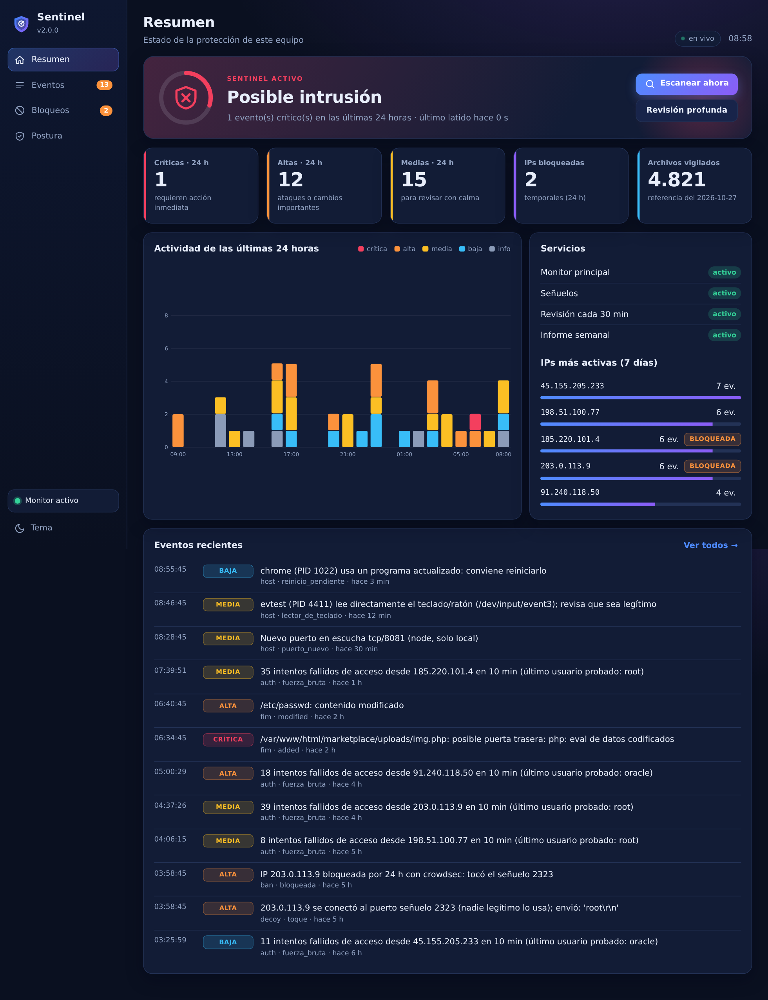

# Sentinel — host-based intrusion detection for Linux (HIDS)

[](https://github.com/saraivaruas/sentinel-hids/actions/workflows/tests.yml)
[](LICENSE)


**Sentinel** is an open-source **host-based intrusion detection system (HIDS)** for Linux. It watches **file integrity**, finds **web shells and reverse shells**, **SSH/sudo brute force**, **port scans** and **suspicious processes**, runs **honeypot** decoy ports, temporarily **blocks attackers**, and warns you with **pop-up alert windows** and a local **graphical dashboard**. Pure Python standard library — no third-party packages. 🇪🇸 [Versión en español](README.md).



## What it detects

| Detector | What it does |
|---|---|
| **File integrity (FIM)** | SHA-256 baseline + permissions + owner of `/etc/passwd`, `shadow`, `sudoers`, SSH, PAM, cron, systemd units, `/usr/local/bin`, `authorized_keys`… New/changed/removed files, redirected symlinks, opened permissions and **new SUID/SGID**. Real-time (inotify) watching of whole directories, so it catches the rename-replace used by `useradd`/`vipw`. |
| **Web shells** | New or modified files in web roots (e.g. `/var/www/html`) are scanned for web-shell and reverse-shell signatures (`eval(base64_decode(...))`, `system($_POST…)`, `/dev/tcp/…`, `curl \| sh`). |
| **Live attacks** | Reads the systemd journal: SSH/sudo/su brute force, successful login after failures, remote root and **port scans** (firewall drops). |
| **Honeypots** (optional) | Decoy ports (SSH 2222, Telnet 2323, RDP 3390, VNC 5900, 60009) in an unprivileged, sandboxed process. **Off by default** because they open ports; enable them in *Settings* or with `sudo sentinel senuelos activar`. Whoever connects is logged and blocked. |
| **Host** | New listening ports (or ports that become public), processes running from `/tmp`, deleted binaries, crypto-miners, unexpected keyboard readers, USB devices, kernel modules, new/UID 0/passwordless accounts, hidden processes, new SUID files. |
| **Posture audit** | `sentinel audit`: 16 configuration checks with the fix for each (firewall, SSH, web permissions, kernel parameters, updates, exposed credentials…). |

**PIN protection:** set a PIN in *Settings*; without it Sentinel cannot be stopped, uninstalled, reconfigured, allow-listed or have its integrity baseline accepted. Hashed with PBKDF2, locks out after 5 failures, alerts on every attempt, and keeps watching if someone tries to stop it without the PIN (root can still `kill -9` anything; the PIN closes the normal paths and leaves a trail).

**Response:** attackers are blocked **temporarily** (24 h) with CrowdSec, firewalld, ufw or iptables — never your LAN, loopback or Tailscale. Sentinel **never kills processes or touches your files**.
**Alerts:** private JSONL log, journald, a toast in the bottom-right corner of the screen that closes by itself (optionally a big pop-up window), optional e-mail or phone (ntfy).

## What it blocks and what it only reports

Sentinel **blocks IP addresses, nothing else**. Everything else is detected and reported; it never kills processes or touches your files.

**Blocks an IP for 24 h** (CrowdSec, firewalld, ufw or iptables) after: 5 failed logins in 10 min (SSH/sudo/su), a port scan (12 ports in 60 s from the firewall log, or SYN/UDP/stealth scans seen by packet capture), a SYN flood (>300 attempts in 10 s) or ping flood (>100 in 10 s), or touching a honeypot. Thresholds live in `[auth]` and `[packets]`. It never blocks your LAN, loopback, Tailscale or the allow-list.

**Only reports:** changed/new/deleted system files and new SUID, web shells, remote root or login after many failures, processes from `/tmp` / deleted binaries / miners / trojan ports, new listening ports, keyboard readers, USB, kernel modules, new accounts, firewall changes made outside Sentinel, and Docker-published ports that bypass the firewall.

**Closing ports** is done by the separate **Firewall module** (`sentinel firewall plan | aplicar`, ufw or iptables): it keeps only the ports you configure open (80/443 by default, plus the SSH this host serves), applies changes on trial with automatic rollback, and shows the real exposure in the dashboard.

## Install (dependencies are installed for you)

```bash
sudo apt install ./sentinel_2.4.0_all.deb     # Debian/Ubuntu: apt pulls every dependency
sudo ./install.sh                             # Ubuntu/Debian, Fedora/RHEL, Arch, openSUSE (add --dry-run to preview)
./install-gui.sh                              # guided installer with windows (asks for admin authorization in a dialog)
```

Then: `sentinel status`, `sentinel test` (an alert window should pop up), `sentinel audit`, `sentinel ui` (dashboard).

Requires Python ≥ 3.8 and systemd. Tested in CI on Ubuntu 22.04 and 24.04.

## Limits

Not an antivirus. An attacker who already has **root** can stop Sentinel (it makes that harder and alerts if it goes silent; use remote alerts for that case). Web-shell signatures cover common patterns, not advanced obfuscation. Install it on a machine you consider clean: the integrity baseline is taken at install time.

## Contributing

MIT-licensed, contributions welcome — **all changes go through a reviewed Pull Request**; nobody pushes to `main`. See [CONTRIBUTING.md](CONTRIBUTING.md). Report vulnerabilities privately: [SECURITY.md](SECURITY.md).

## License

[MIT](LICENSE) © 2026 Jorge Luis Saraiva Ruas.

<sub>Keywords: HIDS, host intrusion detection, file integrity monitoring, FIM, web shell detector, honeypot, SSH brute force detection, port scan detection, Linux security, blue team, CrowdSec, ufw, firewalld, systemd, security dashboard, threat detection, incident response.</sub>
