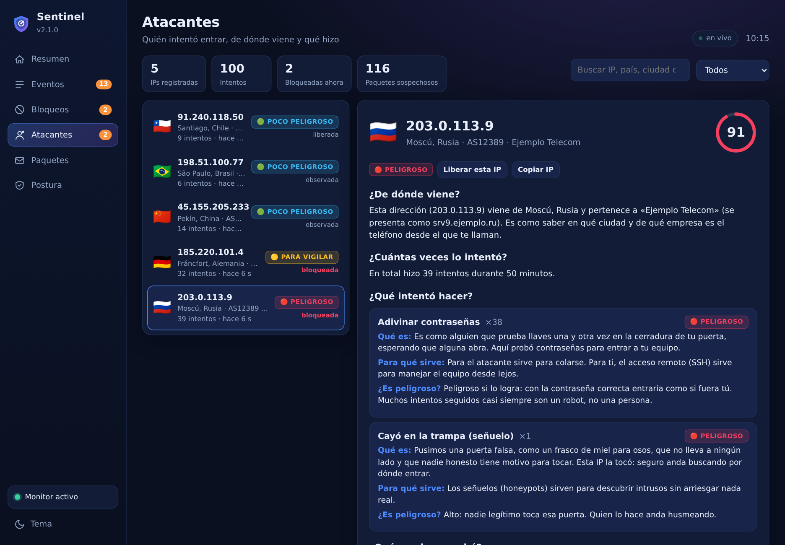
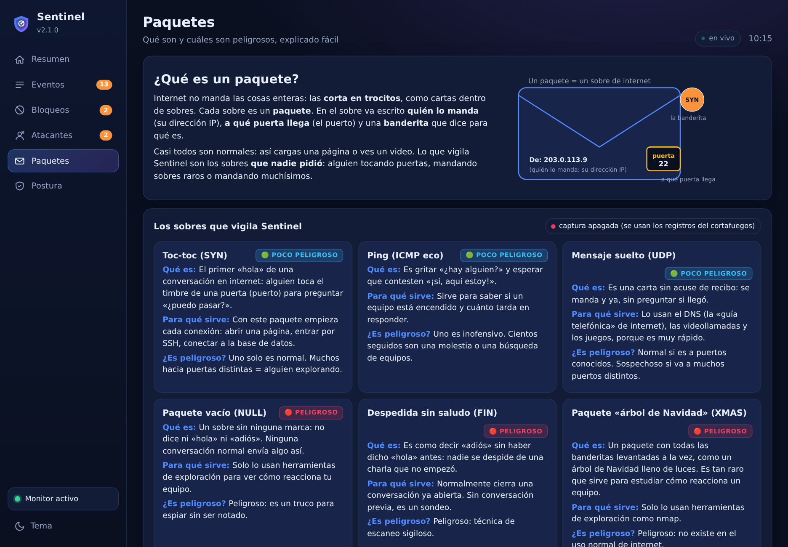

# Sentinel — detector de intrusiones para Linux (HIDS)

[](https://github.com/saraivaruas/sentinel-hids/actions/workflows/tests.yml)
[](LICENSE)


**Sentinel** es un **sistema de detección de intrusiones para el equipo (HIDS)** de código abierto para Linux: vigila la **integridad de archivos**, detecta **puertas traseras web (webshells)**, **fuerza bruta**, **escaneo de puertos** y **procesos sospechosos**, tiene **señuelos (honeypots)**, bloquea atacantes de forma temporal y te avisa con **ventanas de alerta** y un **panel gráfico**. Escrito en Python, sin librerías externas. 🇬🇧 [English version](README.en.md).


> Reemplaza a «Sentinel-JSR» (v1, scripts de shell). Se instala solo, con sus dependencias, en Ubuntu/Debian, Fedora/RHEL, Arch y openSUSE.

## Qué detecta

| Detector | Qué hace | Gravedad típica |
|---|---|---|
| **Integridad de archivos** | Referencia SHA-256 + permisos + dueño de `/etc/passwd`, `shadow`, `sudoers`, SSH, PAM, cron, servicios, `/usr/local/bin`, llaves `authorized_keys`, etc. Detecta archivos nuevos, modificados, eliminados, enlaces redirigidos, permisos abiertos y **SUID/SGID nuevos**. Vigila en vivo (inotify) carpetas completas, así que detecta el reemplazo de archivos que hacen `useradd` o `vipw`. | alta / crítica |
| **Puertas traseras web** | En carpetas web (`/var/www/html`) revisa los archivos nuevos o modificados contra firmas de webshells y shells inversas (`eval(base64_decode(...))`, `system($_POST...)`, `/dev/tcp/...`, `curl \| sh`). | crítica |
| **Ataques en vivo** | Lee el journal: fuerza bruta SSH/sudo/su, acceso exitoso tras intentos fallidos, root remoto y **escaneo de puertos** (bloqueos del cortafuegos). | alta / crítica |
| **Señuelos** | Puertos falsos (2222, 2323, 3390, 5900, 60009) sin servicio real, en un proceso sin privilegios y aislado. Quien se conecta queda registrado y bloqueado. | alta |
| **Equipo** | Puertos nuevos en escucha o que pasan de local a públicos, procesos que corren desde `/tmp`, con el ejecutable borrado o con nombre de minero, conexiones a puertos de troyanos, lectores de teclado no esperados, USB, módulos del kernel, cuentas nuevas, UID 0 duplicado, cuentas sin contraseña, procesos ocultos y SUID nuevos. | media / crítica |
| **Postura** | `sentinel audit`: 16 revisiones de configuración con su arreglo (cortafuegos, SSH, permisos web, parámetros del kernel, actualizaciones, credenciales con permisos abiertos…). | — |

**Respuesta.** Los atacantes se bloquean de forma **temporal** (24 h) con CrowdSec o ufw; nunca la red local, Tailscale ni la lista blanca. A diferencia de la v1, **no detiene procesos ni modifica tus archivos**.
**Avisos.** Registro JSONL privado, journal, notificación de escritorio, **ventana emergente de alerta** y, opcionalmente, correo o celular (ntfy). No repite el mismo aviso en una hora.

**Ventanas de alerta.** Desde la gravedad alta (`popup_min`, configurable) salta una ventana en tu pantalla con el detalle y el botón **Abrir panel**; las críticas no se cierran solas, las demás a los 2 minutos. Máximo 3 por minuto para no inundarte. Funciona desde el servicio (root) hacia tu sesión gráfica, X11 o Wayland. Prueba con `sentinel test`.

## Expedientes de atacantes y paquetes

Cuando alguien ataca, Sentinel no solo lo bloquea: **abre un expediente** de esa IP y lo explica como si se lo contaras a un niño.

- **De dónde viene:** país, ciudad, empresa y red (archivo local DB-IP o servicios públicos RIPEstat/RDAP; `geo_mode` en `[intel]`; offline = no sale nada de tu equipo).
- **Cuántos intentos hizo y de qué tipo:** adivinar contraseñas, probar usuarios o llaves, escaneo de puertos, escaneo sigiloso, inundación de timbres (SYN flood), ping masivo, caer en un señuelo. Con los usuarios y los puertos que probó.
- **Paquetes:** captura de red propia (sin `tcpdump`, necesita root) que mira solo lo no solicitado —intentos de conexión, paquetes raros, pings— y los clasifica («toc-toc», «portazo», «árbol de Navidad»…). No guarda el contenido, solo quién, a qué puerta y de qué clase.
- **Qué hizo Sentinel:** bloqueo de 24 horas, historial de bloqueos y liberaciones (quién y cuándo). Puedes **liberar** o **bloquear** una IP desde el panel o con `sentinel bans unban|ban IP`.
- **Explicado fácil:** para cada cosa, «qué es», «para qué sirve» y «¿es peligroso?» con semáforo (🟢 🟡 🔴), más una página «Paquetes» con un glosario.

```bash
sentinel attackers                 # lista con riesgo, lugar e intentos
sentinel attacker 203.0.113.9      # expediente completo, explicado fácil (--tecnico: sin explicaciones)
sentinel packets                   # qué es un paquete y los últimos sospechosos
sentinel bans ban 203.0.113.9 --horas 24
```




La captura de paquetes se verificó con tráfico real en un contenedor (`tools/prueba_captura_real.py`). Se desactiva con `[packets] enabled = no`. Privacidad: en modo en línea la IP del atacante se consulta a RIPEstat/RDAP; los expedientes se guardan 90 días.

## Panel gráfico

Se abre desde el menú de aplicaciones («Sentinel») o con `sentinel ui`, como una ventana de aplicación. Funciona sin internet: es una página local que solo escucha en `127.0.0.1` y exige una llave que se guarda en `~/.config/sentinel/ui_token`.

- **Resumen:** estado de la protección (Protegido, Para revisar, Requiere atención, Posible intrusión), eventos por gravedad, actividad de 24 horas, servicios, IPs más activas y eventos recientes en vivo.
- **Eventos:** historial con filtros por gravedad, período y búsqueda; cada fila se abre para ver sus datos.
- **Bloqueos:** IPs bloqueadas con su tiempo restante y botón para desbloquear; lista blanca.
- **Postura:** puntaje de seguridad del equipo y cada hallazgo con su comando de arreglo (con botón «Copiar»).
- **Acciones:** escanear ahora, revisión profunda, desbloquear y lista blanca. Las que necesitan administrador piden tu clave con la ventana normal del sistema (`pkexec`); el panel nunca corre como root.
- Tema oscuro y claro, y adaptado a celular/ventanas angostas.

Seguridad del panel: valida `Host` y `Origin` (contra DNS-rebinding y CSRF), CSP estricta, y todo texto de los eventos —que puede venir de un atacante— se muestra como texto, nunca como HTML. Las acciones son una lista cerrada con valores validados. Para verlo con datos de ejemplo sin instalar nada: `python3 tools/demo_datos.py /tmp/demo` y luego `SENTINEL_STATE=/tmp/demo/state SENTINEL_LOG=/tmp/demo/log python3 -m sentinel ui`.

## Instalar (baja e instala todo lo necesario)

Sentinel no usa librerías de Python externas. Lo que sí necesita del sistema (inotify, notificaciones, polkit, un motor de bloqueo…) **se instala solo**. Hay cuatro formas:

**0. Instalador con ventanas (la más cómoda en un escritorio).** Doble clic en `install-gui.sh` (o en «Instalar Sentinel») o `./install-gui.sh`. Salta una ventana de bienvenida, otra para elegir opciones, la **ventana de autorización del sistema** (donde escribes tu clave de administrador), una barra de avance y, al terminar, una ventana de alerta de prueba y la pregunta de si abrir el panel. Si algo falla muestra el detalle; si cancelas la autorización no cambia nada.

**1. Paquete .deb (Ubuntu, Debian, Mint…) — la más simple.** `apt` resuelve y baja las dependencias:

```bash
sudo apt install ./sentinel_2.0.0_all.deb
```

**2. Instalador (Ubuntu/Debian, Fedora/RHEL, Arch, openSUSE).** Detecta la distribución, calcula qué falta, lo instala con `apt`, `dnf`, `pacman` o `zypper`, y después instala Sentinel:

```bash
sudo ./install.sh --dry-run      # primero mira qué haría, sin cambiar nada
sudo ./install.sh                # instala dependencias + Sentinel, retira la v1 (copia en /root/sentinel-v1-respaldo) y arranca
```

**3. Descarga e instalación en un paso**, desde cualquier servidor donde publiques el `.tar.gz` (verifica la huella antes de instalar; sin huella no instala):

```bash
sudo SENTINEL_URL=https://tu-servidor/sentinel-2.0.0.tar.gz SENTINEL_SHA256=<huella> bash get-sentinel.sh
```

Después de instalar: `sentinel status`, `sentinel test` (debería salir una notificación) y `sentinel audit`.

| Paquete | Se instala si falta | Para qué |
|---|---|---|
| python3 (≥ 3.8), systemd, procps, iproute2, util-linux | siempre | base |
| inotify-tools | sí | vigilancia de archivos en vivo |
| libnotify, polkit | sí | avisos de escritorio y acciones del panel con clave |
| logrotate | sí | rotación de registros |
| ufw / firewalld / iptables | solo si no hay ningún motor de bloqueo | bloquear atacantes (se instala, **no** se activa) |
| lynis | sí (donde existe) | informe semanal |
| CrowdSec | no (opcional, [instrucciones oficiales](https://docs.crowdsec.net/)) | bloqueo colaborativo; si está activo, Sentinel lo prefiere |

Motor de bloqueo (`[ban] backend = auto`): CrowdSec → firewalld → ufw (activo) → iptables. Todos con caducidad (24 h).

Opciones del instalador: `--sin-dependencias`, `--sin-limpiar` (no toca la v1), `--exponer-senuelos` (activa los señuelos y abre sus puertos; por defecto **no se abre ningún puerto**, y el escaneo externo se detecta igual con el cortafuegos).
Desinstalar: `sudo apt purge sentinel` o `sudo ./uninstall.sh` (`--todo` borra también registros y referencias).
Generar la versión (paquete + tarball + huellas): `packaging/make-release.sh` → `dist/`.

## Uso diario

| Comando | Para qué |
|---|---|
| `sentinel status` | servicios, latido, referencia, bloqueos y últimos eventos |
| `sentinel events --min medium --horas 48` | ver eventos |
| `sentinel scan [--deep]` | revisar ahora (código de salida 0 limpio, 1 media, 2 alta o crítica) |
| `sentinel baseline accept [rutas]` | aceptar un cambio legítimo como nueva referencia |
| `sentinel bans` / `sentinel bans unban IP` | ver o quitar bloqueos |
| `sentinel allow ip 203.0.113.7` | lista blanca (`ip`, `proc`, `port`, `path`) |
| `sentinel audit` | postura de seguridad |
| `sentinel ui` | abre el panel gráfico |
| `sentinel report --lynis` | informe HTML (semanal, automático) con el índice de Lynis |

Configuración: `/etc/sentinel/sentinel.conf` (parte de `etc/sentinel.conf.example`). Registros: `/var/log/sentinel/`.

## Cómo está armado

```
sentinel-monitor (root)  ── vigilancia en vivo de archivos (inotify) · journal · señuelos · revisión del equipo cada 5 min · latido
sentinel-honeypot (usuario «sentinel», aislado)  ── puertos señuelo; solo escribe su registro
sentinel-scan.timer      ── revisión cada 30 min y aviso si el monitor deja de latir
sentinel-report.timer    ── informe y Lynis cada lunes
```

## Pruebas

```bash
cd tests && python3 -m unittest discover -s .     # 100 pruebas, ~12 s, sin permisos de administrador
```

Incluyen los dos fallos de la v1: el reemplazo de archivos por renombre y la extracción de la IP del atacante.

## Límites (lo que Sentinel no es)

- No es un antivirus: detecta cambios y comportamientos sospechosos, no analiza malware por firmas completas.
- Un atacante que ya tiene **root** puede detenerlo o alterar sus referencias. Sentinel lo hace más difícil (programa y referencias son de root, latido vigilado, vigila su propio directorio) y lo avisa si queda mudo, pero para ese caso hace falta además un registro remoto (correo/ntfy) o un monitoreo externo.
- La referencia de integridad se crea al instalar: instálalo en un equipo que consideres limpio.
- Las firmas de puertas traseras cubren patrones comunes, no ofuscación avanzada.

## Contribuir

Es código abierto (MIT) y las mejoras son bienvenidas, pero **todo cambio entra mediante un Pull Request** revisado por el mantenedor: nadie escribe directamente en `main`. Lee [CONTRIBUTING.md](CONTRIBUTING.md). Las vulnerabilidades se reportan en privado: [SECURITY.md](SECURITY.md).

## Licencia

[MIT](LICENSE) © 2026 Jorge Luis Saraiva Ruas.

<sub>Palabras clave: HIDS, detección de intrusiones, intrusion detection, monitoreo de integridad de archivos, file integrity monitoring, FIM, detector de webshells, honeypot, fuerza bruta SSH, escaneo de puertos, seguridad Linux, blue team, CrowdSec, ufw, firewalld, systemd, panel de seguridad.</sub>
